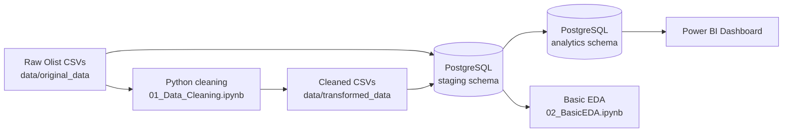
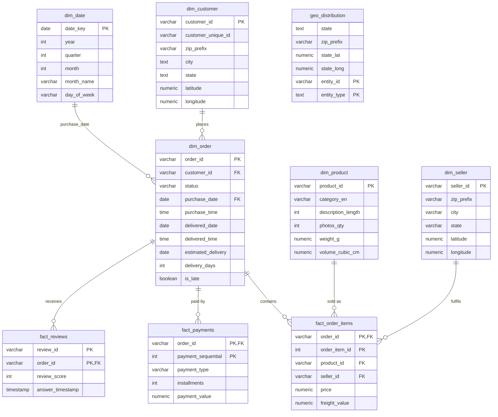

# Olist Brazilian E-Commerce: E2E Data Analytics Project

An end-to-end analytics project on the public Olist Brazilian e-commerce dataset: raw CSVs are profiled and cleaned in Python, loaded into a layered PostgreSQL warehouse (`staging` → `analytics`), and served to a 3-page Power BI dashboard covering sales, products and sellers, and logistics.


---

## Table of Contents

1. [Project Overview](#1-project-overview)
2. [Business Questions](#2-business-questions)
3. [Dataset](#3-dataset)
4. [Tech Stack](#4-tech-stack)
5. [Architecture](#5-architecture)
6. [Repository Structure](#6-repository-structure)
7. [Data Cleaning and Quality Decisions](#7-data-cleaning-and-quality-decisions)
8. [Data Model](#8-data-model)
9. [Power BI Dashboard](#9-power-bi-dashboard)
10. [Key Insights](#10-key-insights)
11. [Setup and Installation](#11-setup-and-installation)
12. [Assumptions and Limitations](#12-assumptions-and-limitations)
13. [Key Learnings](#13-key-learnings)
14. [Future Improvements](#14-future-improvements)
15. [Acknowledgments](#15-acknowledgments)
16. [Author](#16-author)

---

## 1. Project Overview

Olist is a Brazilian marketplace that connects small businesses to online sales channels. The public dataset describes roughly 100K orders placed between 2016 and 2018, including customers, sellers, products, payments, reviews and delivery timestamps.

This project takes that data from raw files to decision-ready reporting:

- **Profile and clean** the raw CSVs in Python, resolving the conflicts that block a proper relational design (duplicate keys, missing foreign key targets, untranslated categories).
- **Model** the data in PostgreSQL using two schemas: `staging` (cleaned, relational copy of the source) and `analytics` (dimensional model built for reporting).
- **Explore** the staging tables to decide what the analytics schema should contain.
- **Visualise** the results in a Power BI dashboard with three pages: Sales, Products and Sellers, and Logistics.

---

## 2. Business Questions

| Area | Question |
|---|---|
| Sales | How much revenue is generated, and how does it trend by month and year? |
| Sales | Which states drive the most business? |
| Sales | When (day of week and hour) are customers most active? |
| Sales | What is the Average Order Value? |
| Reviews | What is the Average Star Ratings of any order? |
| Products and Sellers | Which product categories and sellers generate the most sales? |
| Products and Sellers | How has the number of active sellers changed over time? |
| Logistics | How long do deliveries take, and what share of orders arrive late? |
| Logistics | Does a late delivery affect customer review scores? |
| Logistics | Which payment methods do customers prefer? |
| Geography | Where are customers and sellers located? |

---

## 3. Dataset

**Source:** [Brazilian E-Commerce Public Dataset by Olist (Kaggle)](https://www.kaggle.com/datasets/olistbr/brazilian-ecommerce)

Row counts of the staging tables after loading:

| Table | Rows | Description |
|---|---:|---|
| `customers` | 99,441 | One row per order-level `customer_id`; `customer_unique_id` identifies the actual person |
| `geolocation` | 19,177 | One row per zip-code prefix (after cleaning) |
| `orders` | 99,441 | Order status and purchase, approval, shipping, delivery and estimated delivery dates |
| `order_items` | 112,650 | One row per item in an order |
| `order_payments` | 103,886 | One row per payment (an order can have several) |
| `order_reviews` | 99,224 | Review score and optional comments |
| `products` | 32,951 | Category, size and weight attributes |
| `sellers` | 3,095 | Seller location |

The source files also include `product_category_name_translation.csv`, used to translate category names to English.

> The raw CSVs are not committed to this repository. Download them from Kaggle and place them in `data/original_data/` (see [Setup](#11-setup-and-installation)).

---

## 4. Tech Stack

| Layer | Tools |
|---|---|
| Data profiling and cleaning | Python, pandas, NumPy |
| EDA and visualisation | matplotlib, seaborn |
| Database | PostgreSQL, pgAdmin (ERD design) |
| Python-to-database connection | SQLAlchemy, psycopg2, python-dotenv |
| Business intelligence | Power BI Desktop (Power Query, DAX, measures, parameters) |

---

## 5. Architecture





**Flow in words**

1. **Clean:** the notebook fixes the issues that would break primary and foreign keys, then writes cleaned CSVs for geolocation and products. The other tables load straight from the original files.
2. **Stage:** `COPY` loads the CSVs into the `staging` schema, which keeps the original table structure with primary keys, foreign keys and constraints.
3. **Explore:** the EDA notebook reads the staging tables to profile missing values and decide how to shape the analytics layer.
4. **Transform:** `INSERT ... SELECT` statements build the dimensional model in the `analytics` schema.
5. **Report:** Power BI connects to the `analytics` schema.

---

## 6. Repository Structure

```
olist-ecommerce-analytics/
├── README.md
├── requirements.txt
├── .gitignore
│
├── notebooks/
│   ├── 01_Data_Cleaning.ipynb        # raw data analysis, key definition, cleaned CSVs
│   └── 02_BasicEDA.ipynb             # EDA on staging tables
│
├── data/
│   ├── original_data/            # raw Kaggle CSVs (not committed)
│   └── transformed_data/         # output of 01_Data_Cleaning.ipynb
│
├── sql/
│   ├── 01_Create_db.sql
│   ├── 02_Create_Schemas.sql
│   ├── 02_Create_StagingTables.sql
│   ├── 03_InsertData.sql         # CSV -> staging
│   ├── 04_Create_AnalyticsTables.sql
│   ├── 05_CreateViews.sql        # staging.date_limits
│   ├── 06_InsertData.sql         # staging -> analytics
│   └── 07_AnalyticViews.sql      # analytics.date_limits
│
├── powerbi/
│   ├── AnalysisReport.pbix
│   ├── DAX_measurements.md
|   ├── Sales.png
|   ├── Products_And_Sellers.png
|   └── Logistics.png
|   
│
└── docs/
    ├── Olist_documentations.md   # Explained Tables Schema
    ├── dax.md                    # Explained all DAX Measures used in the dashboard
```

---

## 7. Data Cleaning and Quality Decisions

All decisions below are made in `01_Data_Cleaning.ipynb`, the SQL scripts, or `02_BasicEDA.ipynb`.

| # | Issue found | Decision | Why |
|---|---|---|---|
| 1 | `geolocation` has about 1,000,163 rows but only 19,015 distinct zip-code prefixes, so the prefix is not unique | Group by prefix: **mean** of latitude and longitude, **first** city and state | Gives one row per prefix, so it can be a primary key |
| 2 | **162** zip-code prefixes used by customers or sellers do not exist in `geolocation` | Append them to `geolocation` with null latitude, longitude, city and state | Keeps the foreign keys from `customers` and `sellers` to `geolocation` valid without dropping any customers or sellers |
| 3 | Zip-code prefixes are read as integers by pandas, which drops leading zeros | Read them as strings (`dtype=str`) and store as `VARCHAR(5)` | Preserves values like `01046` |
| 4 | `order_items`: neither `order_id` nor `order_item_id` is unique on its own | Composite primary key `(order_id, order_item_id)` | Each order can contain several items |
| 5 | `order_payments`: an order can have several payments | Composite primary key `(order_id, payment_sequential)` | Models split payments correctly |
| 6 | `order_reviews`: `review_id` repeats across orders and `order_id` repeats across reviews, but the pair is unique | Composite primary key `(order_id, review_id)` | The only combination that is unique |
| 7 | Orders have missing approval, carrier and delivery timestamps | Keep as null | Missing values are mostly explained by status (canceled, unavailable, invoiced, processing, shipped), and only a few are genuine data errors |
| 8 | Products have missing category and metadata (610 products) and 2 products with missing dimensions | In `analytics.dim_product`: category becomes `UNKNOWN`, missing description length, photo count and weight become `0` | Dropping them would remove real `product_id`s referenced by order items |
| 9 | Product categories are in Portuguese | Translate using `product_category_name_translation.csv`, fall back to the original name if no translation exists | Readable category names in reports |
| 10 | Review comment title and message are mostly empty | Keep as null | Comments are optional; most customers only give a star rating |

---

## 8. Data Model

### Staging schema

Mirrors the source structure with keys and constraints: `geolocation`, `customers`, `products`, `sellers`, `orders`, `order_items`, `order_payments`, `order_reviews`. `customers` and `sellers` reference `geolocation` through the zip-code prefix. A `CHECK` constraint restricts `review_score` to 1-5.

### Analytics schema

A dimensional model built for reporting:



| Table | Grain (one row per...) | Notes |
|---|---|---|
| `fact_order_items` | order item | Source of sales: `SUM(price)` |
| `fact_payments` | payment within an order | Payment type and installments |
| `fact_reviews` | review of an order | Review score and answer time |
| `dim_order` | order | Also holds derived delivery metrics: `delivery_days` and `is_late` |
| `dim_customer` | order-level `customer_id` | Enriched with coordinates from geolocation |
| `dim_seller` | seller | Enriched with coordinates from geolocation |
| `dim_product` | product | English category, volume (length × width × height) |
| `dim_date` | calendar day | Generated for 2016-09-01 to 2018-12-31 |
| `geo_distribution` | customer or seller entity | Feeds the map visuals; customers are de-duplicated by `customer_unique_id`, and coordinates are the average per state |

**Derived columns in `dim_order`**

- `delivery_days` = delivered date − purchase date
- `is_late` = `true` when the delivered date is after the estimated delivery date, `false` when on time, null when the order was not delivered

**Views**

- `staging.date_limits`: minimum and maximum dates across orders and reviews, used to choose the `dim_date` range
- `analytics.date_limits`: first and last purchase date for each year

---

## 9. Power BI Dashboard

The dashboard ([power_bi/AnalysisReport.pbix](power_bi/AnalysisReport.pbix)) has three pages with shared filters for Year, Month, State and Product Category, plus a Sales / Order Count toggle.

### Entity-Relationship Diagram


### Sales


KPI cards (Total Revenue, Total Orders, Average Order Value, Average Rating), YoY growth, monthly sales trends by year, sales by state, and an hour-by-weekday activity heatmap.

### Products and Sellers


KPI cards (Active Sellers, Active Customers, Product Categories, Total Products), seller leaderboard, top product categories, seller performance scatter (orders vs sales), and active sellers over time.

### Logistics


KPI cards (Average Freight Value, Average Delivery Days, Average Delivery Delay), delayed vs on-time share, payment method usage, review score distribution for delayed vs on-time orders, and customer and seller location maps.

### Power Query and modelling steps

- Formatted `fact_order_items.price` and `freight_value` as currency using Column Tools (the underlying type stays decimal).
- Made `dim_product[category_en]` more readable.
- Added a purchase-hour column to `dim_order` for the heatmap.
- Added a day-of-week number column to `dim_date` so weekdays sort correctly.
- Added a delivery-delay column to `dim_order` (0 if delivered on or before the estimate, otherwise days late; null if either date is missing).
- Replaced blank values in `is_late` with null, and converted it from true/false to *Delayed* / *Not Delayed*.
- Formatted `payment_type` values in `fact_payments`.


## 10. Key Insights

- **Scale:** about $13.6M in sales across roughly 99K orders, an average order value of about $137.8 and an average rating of about 4 out of 5.
- **Year on Year Growth:** is only 0.2% and it is valid for only 2017 to 2018 since we do not have much data for 2016.
- **One time order:** There are 99k orders and 96k customer across 3 years - This shows the customer retention is pretty low.
- **Geography:** São Paulo (SP) is the largest market at about $5.2M, well ahead of RJ (about $1.8M) and MG (about $1.6M). And a huge base of customers and sellers is SP.
- **Categories:** Health & Beauty, Watches & Gifts, and Bed Bath Table lead in sales (about $1.0M-$1.3M each). Where Watches & Gifts have about 5-6k orders but $1.2M sales - This way we can identify which product categories have higher product value.
- **Seller growth:** the number of active sellers per month grows steadily through 2017 and 2018.
- **Customer activity:** Higher number of orders are placed between 10AM-4PM on Weekdays. A slight dip is observed in order placement between 11AM to 12PM (maybe because of lunch time). 
- **Payments:** credit card is by far the most used payment method, followed by boleto, voucher and debit card.
- **Delivery:** about 7% of orders are delivered late. Average delivery time is 12.5 days.
- **Delivery vs satisfaction:** late delivery has a strong link with low ratings. About 54% of delayed orders receive a 1-star review, compared with about 7% of on-time orders.
---

## 11. Setup and Installation

> Developed on Windows with PostgreSQL, pgAdmin and Power BI Desktop. Power BI Desktop is Windows-only.

> If you want to see the Power BI Dashboard only - just download [power_bi\AnalysisReport.pbix](power_bi/AnalysisReport.pbix) and open in your power bi desktop

### Prerequisites

- Python 3.10+
- PostgreSQL (with pgAdmin or `psql`)
- Power BI Desktop
- A Kaggle account to download the dataset

### 1. Clone the repository

```bash
git clone https://github.com/ArunNegi112/Olist-E2E-analytics-pipeline.git
cd Olist-E2E-analytics-pipeline
```

### 2. Download the data

Download the dataset from [Kaggle](https://www.kaggle.com/datasets/olistbr/brazilian-ecommerce) and extract the 9 CSV files into `data/original_data/`. Create an empty `data/transformed_data/` folder for the cleaned output.

### 3. Create the Python environment

```bash
python -m venv venv
venv\Scripts\activate          # Windows
pip install -r requirements.txt
```

### 4. Run the cleaning notebook

Launch Jupyter from the repository root and run all cells of `01_Data_Cleaning.ipynb`.   
Note - These juypter and SQL files are to be ran only once
This writes:

- `data/transformed_data/olist_geolocation_dataset_cleaned.csv`
- `data/transformed_data/olist_products_dataset_transformed.csv`

### 5. Create the database and schemas

Run the SQL scripts in the order below. Script 01 must be run while connected to the default `postgres` database. All the others run against `OlistCustomerDB`.

| Order | Script | Purpose |
|---|---|---|
| 1 | `01_Create_db.sql` | Creates the `OlistCustomerDB` database |
| 2 | `02_Create_Schemas.sql` | Creates the `staging` and `analytics` schemas |
| 3 | `02_Create_StagingTables.sql` | Creates the staging tables with keys and constraints |
| 4 | `03_InsertData.sql` | Loads the CSVs into staging |
| 5 | `04_Create_AnalyticsTables.sql` | Creates the dimension and fact tables |
| 6 | `05_CreateViews.sql` | Creates `staging.date_limits` |
| 7 | `06_InsertData.sql` | Populates the analytics tables from staging |
| 8 | `07_AnalyticViews.sql` | Creates `analytics.date_limits` |

> **Important:** `03_InsertData.sql` uses absolute file paths from my original machine (`C:\Users\Arun\...`). Update every path to the location of the CSV files on your machine before running it and allow all the permissions. `COPY` reads files on the database server, so the PostgreSQL service must have permission to read those folders.

### 6. Configure the database password

Create a `.env` file in the repository root (the EDA notebook reads it):

```
PASSWORD=your_postgres_password
```

The notebook connects to `postgresql://postgres:<PASSWORD>@localhost:5432/OlistCustomerDB`.

### 7. Run the EDA notebook

Run `02_BasicEDA.ipynb` to profile the staging tables.

### 8. Open the dashboard

1. Open `powerbi/olist_dashboard.pbix` in Power BI Desktop.
2. If prompted, update the data source: server `localhost:5432`, database `OlistCustomerDB`.
3. Enter your PostgreSQL credentials and refresh the data.

---

## 12. Assumptions and Limitations

- **Currency:** the source data does not label its currency, for convention I'm assuming it as USD ($)
- **Partial years:** the data covers September 2016 to the end of 2018, but 2016 has very few orders and 2018 ends part-way through the year. Year-over-year growth and the tail of the monthly trend and active-seller charts are therefore distorted by incomplete data, not by real declines.
- **Missing geolocation:** 162 zip-code prefixes have no coordinates or city, and the dashboard maps cannot place them. For now I have filled them as null but filling them from an external source is the better long-term fix.
- **Missing product metadata:** in `dim_product`, missing description length, photo count and weight are set to `0`, which can pull averages of those fields down. I have treated them as "unknown" when analysing.
- **Undelivered orders:** `delivery_days` and `is_late` are null for orders without a delivery date.
- **Scope:** the analysis is descriptive (what happened). It does not forecast or model causes.

---

## 13. Key Learnings
#### Things that I learnt while building this project 
- Defining primary and foreign keys from the raw data: composite keys, and creating parent tables before the child tables that reference them.
- Data granularity (grain) and the practical difference between fact and dimension tables.
- Using views in PostgreSQL.
- Separating a raw-like staging layer from a reporting-ready analytics layer.
- Difference between reporting (what happened) and analysis (why it happened and what next).
- Preparing data in Power Query and writing measures for a multi-page dashboard.
- Got better understanding of DAX Queries and Field Parameters
- Understanding where to use what type of visualization and structuring the whole report in a way which is easier for end user to read.
---

## 14. Future Improvements

- Automate the full pipeline with a single script.
- Add SQL validation checks (row counts between layers, orphan keys, duplicate keys, revenue reconciliation).
- Add indexes on frequently joined columns in the `analytics` schema.
- Fill the missing geolocation records from an external source.
- Move the transformation SQL to dbt for testing and lineage.
- Extend from descriptive to diagnostic analysis (for example, quantifying the effect of delivery delay on review scores) and add forecasting.
- Publish the dashboard to Power BI Service and link a public report.
---